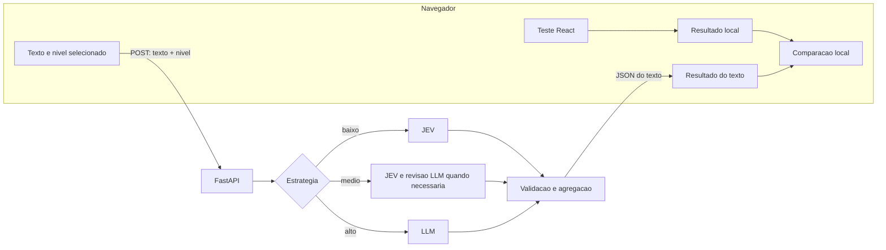

# Plano do aplicativo: teste 8values e comparação com textos

Data: 08/10/2026. Entrega: plano de produto, UX e implementação do MVP.

A proposta é uma aplicação React que permite realizar o teste 8values, guardar o resultado exclusivamente no navegador e analisar textos políticos em uma interface de chat. Uma API Python recebe somente o texto e o modo de processamento. A comparação com o usuário acontece inteiramente no frontend.

## 1. Escopo e decisões principais

| Área | Decisão para o MVP |
|---|---|
| Frontend | React + TypeScript + Vite, com React Router e CSS Modules |
| Estado | Hooks, Context e reducer; separar o perfil local do cliente HTTP |
| Backend | FastAPI + Pydantic, aproveitando o código Python do notebook |
| Persistência no servidor | Sem banco de dados, cadastro ou histórico de textos |
| Resultado pessoal | `localStorage`, com opção de uso apenas na sessão e exclusão explícita |
| Chat | Histórico visual em memória; cada envio é uma classificação independente |
| Comparação | Quatro eixos, calculados no navegador, com diferenças em pontos |
| Entrada | Texto colado/digitado, em português; um texto por envio |
| Execução | Uma requisição HTTP por análise, com limites e prazo máximo |

A escolha de uma SPA reduz o trabalho inicial porque o produto não precisa renderizar resultados pessoais no servidor. Vite é uma das opções documentadas para uma aplicação React construída dessa forma. [Referência React](https://react.dev/learn/build-a-react-app-from-scratch).

PDFs, importação por URL, contas, sincronização entre dispositivos, compartilhamento público, conversa livre com LLM e processamento de documentos enormes ficam para uma etapa posterior. Isso mantém o backend pequeno e o fluxo de dados compreensível.

## 2. Base existente e reaproveitamento

Foram inspecionados os arquivos locais:

- [Pipeline - Passo a Passo.ipynb](<C:/Users/User/Desktop/TCC/Pipeline - Passo a Passo.ipynb>): classificação por eixo, cascata, validação de evidências, segmentação e agregação.
- [TCC.ipynb](C:/Users/User/Desktop/TCC/TCC.ipynb): `Quiz8Values` e cálculo do questionário.
- [questions.json](C:/Users/User/Desktop/TCC/tcc/questions.json): 70 perguntas em português e seus efeitos nos quatro eixos.
- [requirements-pipeline.txt](C:/Users/User/Desktop/TCC/requirements-pipeline.txt): referência de dependências do experimento, a reduzir para a API.

O notebook usa JEV da TypeSafe e Sabiá da Maritaca. A configuração observada é `jev-1.13.0` e `sabia-4`; são referências do experimento, cuja disponibilidade deverá ser verificada na implementação.

| Parte do notebook | Destino no aplicativo |
|---|---|
| `AXIS_SPECS`, rubricas e `NIVEIS_POLARIDADE` | Módulo de domínio versionado |
| `criar_perguntas_jev_2_polos`, `decidir_jev` | Estratégia JEV |
| `motivos_fallback`, `classificar_texto` | Estratégia híbrida |
| `consultar_llm`, esquema Pydantic, `decidir_llm` | Estratégia LLM e validação compartilhada |
| `_score_evidencia_confere` | Verificação de citações antes da agregação |
| `dividir_texto_em_chunks_tokens` | Preparação comum aos três modos |
| `resumir_eixo_ordinal`, `converter_documento_8values` | Agregação e resposta padronizada |
| `Quiz8Values` do TCC | Funções TypeScript puras executadas no navegador |

Extrair as funções para arquivos `.py`; não executar o notebook como parte de uma requisição. Preservar os notebooks como referência de pesquisa.

O runtime da aplicação não incluirá `classificar_lote` com gravação JSONL, manifestos em `runs/`, gráficos Matplotlib, leitura de planos de candidatos ou benchmarks automáticos. Esses elementos pertencem ao experimento e podem armazenar conteúdo enviado.

## 3. Jornada e telas

### Entrada

Apresentar a proposta em uma frase: “Conheça seus valores e compare com as posições presentes em um texto.”

Ação principal: **Fazer meu teste**. Havendo resultado local, mostrar **Continuar para análises** e acesso a **Meu resultado**. Permitir analisar um texto sem teste, deixando a comparação pessoal indisponível até a conclusão do questionário.

Aviso próximo da ação: “Seu teste é calculado neste navegador. Os textos enviados para análise são processados por serviços externos.”

### Questionário

- Uma pergunta por tela, com “Pergunta 12 de 70” e progresso textual.
- Cinco alternativas: concordo fortemente, concordo, neutro/incerto, discordo e discordo fortemente.
- Seleção e botão **Próxima** separados para permitir revisar a resposta antes de avançar.
- Botão **Voltar** preservando a alternativa anterior; revisão de pendências ao final.
- Rascunho em `sessionStorage` para suportar recarregamento da página; opção **Descartar teste**.
- Conclusão somente com as 70 perguntas respondidas; resposta ausente não equivale a neutra.
- Não apresentar uma classificação política durante o preenchimento.

### Meu resultado

Mostrar quatro barras horizontais bipolares, valores numéricos e explicação curta de cada eixo. A pontuação principal pode ser exibida com uma casa decimal; o complemento deve ser apresentado de forma que o par some 100.

| Eixo exibido | Polo A / chave | Polo B / chave |
|---|---|---|
| Econômico | Igualdade / `equality` | Mercado / `wealth` |
| Diplomático | Globo / `peace` | Nação / `might` |
| Civil | Liberdade / `liberty` | Autoridade / `authority` |
| Social | Progresso / `progress` | Tradição / `tradition` |

No contrato interno, os eixos continuam `economic`, `diplomatic`, `state` e `society`, como no pipeline. Os polos mantêm a mesma orientação em todas as telas.

Ações: **Analisar um texto**, **Refazer teste** e **Apagar meus dados locais**. Destacar “Salvo somente neste navegador” apenas após confirmar sucesso na gravação. Rótulos ideológicos e “ideologia mais próxima” não serão o destaque do MVP: o próprio 8values descreve esse enquadramento como menos preciso que os eixos. [Explicação do 8values](https://8values.github.io/).

### Chat de classificação

Desktop: histórico de análises à esquerda, conversa no centro e comparação do texto selecionado à direita. Celular: conversa em uma coluna e alternância entre **Análise** e **Comparação**, preservando o texto digitado. O histórico existe somente durante o uso atual do app.

O campo de envio terá título opcional local, área de texto expansível, contador de caracteres, seletor de processamento e botão **Analisar texto**. Enter cria uma linha; Ctrl/Cmd + Enter envia, com atalho informado. O título não precisa ir para a API.

Cada envio gera um cartão com o modo efetivamente utilizado, resultado por eixo, disponibilidade de evidência e ação **Comparar comigo**. Mudar o seletor vale para o próximo envio; **Reanalisar neste modo** é uma ação explícita que cria outro cartão.

Embora a apresentação seja de chat, o servidor recebe apenas o texto daquele envio. Mensagens anteriores, resultado pessoal e comparações não compõem o prompt.

## 4. Seletor de processamento

Usar um grupo de três opções sempre visíveis, com rótulo e descrição. Padrão proposto: **Médio**. Mostrar os destinatários do texto antes do envio.

| Nível | Texto de apoio | Execução |
|---|---|---|
| Baixo | Análise com JEV | JEV em todos os trechos; nenhuma chamada ao LLM |
| Médio | JEV com revisão por LLM quando necessário | JEV primeiro; LLM revisa apenas eixos encaminhados pelas regras de incerteza |
| Alto | Análise diretamente com LLM | LLM avalia todos os quatro eixos de cada trecho; nenhuma chamada ao JEV |

“Alto” identifica a estratégia escolhida; não significa precisão garantidamente superior. Custo e latência precisam ser medidos: o modo médio também pode chamar os dois serviços em muitos trechos.

**Baixo:** reaproveitar a cascata com `usar_fallback=False` e `llm=None`, preservando marcações de incerteza. Não acionar LLM para criar uma explicação textual. O JEV atual não retorna citações justificativas: mostrar os trechos classificados, sem inventar evidências literais.

**Médio:** preservar a configuração observada: relevância e polaridade com `choice`, margem mínima de relevância 0,60, confiança mínima de nível 0,50 e margem mínima de direção 0,20. Encaminhar por relevância ambígua, empate de nível, baixa confiança ou direção ambígua. Os comparadores são estritamente `<`. Um texto pode terminar sem chamada ao LLM se nenhum eixo precisar de revisão.

**Alto:** criar `classificar_apenas_llm`, usando as mesmas rubricas, esquema e validação de evidências, mas sem executar JEV. Adaptar `decidir_llm` para aceitar ausência de decisão anterior; a lógica `llm_reverteu_relevancia` não se aplica nesse modo. Uma chamada lógica por trecho pode avaliar os quatro eixos juntos. Inicializar apenas os clientes necessários para cada modo.

Nos três casos, a preparação, orientação dos polos e agregação serão iguais. Falhas não trocarão o modo silenciosamente. No médio, falha de revisão mantém abstenção no eixo encaminhado, como no notebook; o JEV inicial pode aparecer em detalhes, mas não substituirá a revisão sem indicação.

## 5. Comparação e interpretação

### Cálculo do questionário no navegador

Para cada eixo, usar os pesos de `questions.json` e os multiplicadores `1`, `0.5`, `0`, `-0.5`, `-1`:

```text
M = soma dos valores absolutos dos efeitos das 70 perguntas no eixo
S = soma de multiplicador_da_resposta × efeito_da_pergunta
pontuacao_A = 100 × (M + S) / (2 × M)
pontuacao_B = 100 − pontuacao_A
```

Na base local inspecionada, os máximos são `econ=195`, `dipl=225`, `govt=320` e `scty=292`. Eles devem ser calculados a partir dos dados e verificados em testes. Preservar a precisão internamente e arredondar só na apresentação. A fórmula e os multiplicadores correspondem à implementação do questionário original. [Código do 8values](https://raw.githubusercontent.com/8values/8values.github.io/master/quiz.html).

### Índice dos textos

Para cada trecho relevante com nível válido, `valor_A = 50 + 25 × nivel`, com nível entre −2 e +2. O índice do documento é a média desses valores; cada trecho elegível tem o mesmo peso, como no notebook. O polo B é o complemento.

- `nivel=0` é conteúdo relevante sem posição predominante e entra como 50.
- Irrelevância e abstenção não entram na média.
- Eixo sem nenhum nível válido retorna `null` em ambos os polos.
- Um índice 50 também pode resultar de trechos opostos; mostrar a distribuição de níveis em detalhes.
- Cobertura significa proporção de trechos com nível válido, não probabilidade de acerto.

Preservar o corte do notebook: menos de 16 trechos válidos por eixo recebe **Evidência limitada**. Textos curtos podem ser analisados, mas frequentemente terão essa indicação. Não reduzir o corte apenas para deixar o resultado visualmente mais convincente.

O bootstrap com 2.000 reamostragens e semente 42 pode permanecer nos detalhes técnicos. O intervalo descreve variabilidade entre trechos, não a chance de o classificador estar correto. Não desenhar um intervalo para eixos sem estimativa ou com menos de dois trechos válidos.

### Apresentação comparativa

Usar uma linha horizontal por eixo, com dois marcadores identificados por forma e texto: **Você** e **Texto**. Abaixo, mostrar a diferença absoluta em pontos da escala 0–100 e a direção relativa.

```text
delta_eixo = indice_texto_A − pontuacao_usuario_A
distancia_eixo = abs(delta_eixo)
```

Exemplo ilustrativo: usuário com 72,5 em Igualdade e texto com 60,0 → diferença de 12,5 pontos; texto relativamente mais próximo de Mercado naquele eixo.

Se o texto não tiver estimativa, apresentar **Sem base para comparar este eixo**. Se houver poucos trechos, apresentar a diferença com **Comparação exploratória — evidência limitada**. Não preencher ausências com 50.

Evitar uma porcentagem global de “compatibilidade” no MVP. O teste pondera respostas a perguntas; o texto agrega níveis ordinais de trechos. Compartilhar polos e escala não comprova equivalência de medida. A comparação será descritiva, com explicações geradas localmente por regras simples, sem enviar o perfil pessoal a um modelo.

## 6. Direção visual e acessibilidade

Proposta visual: fundo claro neutro, texto escuro, uma cor de destaque para ações e cores discretas consistentes por eixo. Evitar vermelho/verde como julgamento de concordância. Usar cartões com espaçamento generoso e tipografia do sistema, sem carregar fontes externas.

Componentes centrais: `QuestionCard`, `AnswerGroup`, `AxisBar`, `ProcessingLevelSelector`, `AnalysisComposer`, `AnalysisCard`, `ComparisonPanel`, `EvidenceDetails` e `LocalDataSettings`.

Metas de acessibilidade: WCAG 2.2 AA, navegação por teclado, foco visível, grupos de alternativas com semântica de rádio, contraste adequado e texto equivalente aos gráficos. Adotar alvos de toque de 44 × 44 px como decisão de conforto do projeto. Testar zoom e largura de 320 px sem rolagem horizontal. Estados assíncronos devem ser anunciados por região de status sem roubar o foco. [Referência WCAG](https://www.w3.org/WAI/WCAG22/quickref/).

| Estado | Comportamento da interface |
|---|---|
| Sem resultado pessoal | Permitir classificação e oferecer o teste para comparar |
| Texto vazio | Desabilitar envio e orientar junto ao campo |
| Texto acima do limite | Explicar o limite e preservar o conteúdo para edição |
| Análise em andamento | Indicador indeterminado, tempo decorrido e botão Cancelar |
| Sem evidência política suficiente | Explicar os eixos sem estimativa, sem criar perfil artificial |
| Falha de um eixo/revisão | Exibir o resultado disponível e a limitação correspondente |
| Timeout/serviço indisponível | Preservar o texto, informar falha e oferecer nova tentativa explícita |
| Armazenamento bloqueado | Continuar em memória e avisar que o resultado não foi salvo |

No MVP com resposta JSON única, não exibir uma porcentagem fictícia de processamento nem supostas etapas recebidas do servidor. Mensagem sugerida: “Analisando o texto. O tempo varia conforme o tamanho e o modo escolhido.”

## 7. Privacidade e LGPD por projeto

Opinião política vinculada a pessoa identificada ou identificável é dado pessoal sensível. Manter o teste no navegador reduz exposição, mas não garante sozinho conformidade com a LGPD. O tratamento de textos e o uso de provedores também precisam de finalidade, base legal adequada, transparência e segurança. Se aplicável consentimento para dados sensíveis, ele deve ser específico e destacado; um aceite genérico não resolve o tratamento de dados de terceiros. [LGPD, arts. 5º, 6º, 11 e 46](https://www.planalto.gov.br/ccivil_03/_ato2015-2018/2018/lei/l13709.htm).

### Fronteira dos dados

| Dado | Localização e duração propostas | Envio externo |
|---|---|---|
| Respostas individuais | `sessionStorage` durante o teste; apagar após concluir ou descartar | Nenhum |
| Resultado agregado | `localStorage` até exclusão pelo usuário; opção de sessão disponível | Nenhum |
| Comparação com o usuário | Memória do frontend; recalculada localmente | Nenhum |
| Texto e análise do chat | Memória do frontend durante o uso; sem histórico persistente no MVP | Apenas o texto do envio atual segue à API |
| Texto em processamento | Memória da API durante a requisição; sem gravação deliberada | Provedores definidos pelo modo |
| Chaves de provedores | Variáveis de ambiente apenas no backend | Autenticação no respectivo provedor |

O texto segue ao JEV no baixo, ao JEV e eventualmente ao LLM no médio, e somente ao LLM no alto. O resultado pessoal nunca acompanha esse fluxo.

O resultado local conterá apenas versão do esquema, versão/hash do questionário, data de conclusão e os quatro valores principais. Os polos opostos serão derivados. Não haverá nome, e-mail ou identificador global do usuário nesse registro.

`localStorage` persiste entre sessões e pode ficar indisponível por configuração do navegador. Por isso, encapsular leitura/gravação, validar o esquema e tratar falhas. Informar que a limpeza dos dados do site remove o resultado. [Comportamento de localStorage](https://developer.mozilla.org/en-US/docs/Web/API/Window/localStorage).

Decisões de implementação:

- Nenhuma rota da API recebe respostas, pontuação pessoal ou diferença entre usuário e texto.
- Resultados não aparecem em query strings, fragmentos de URL, cookies, títulos de página ou links compartilháveis. Reimplementar o questionário localmente; não embutir o site original.
- **Apagar meus dados locais** limpa as chaves do app, estado em memória e comparação; propagar a exclusão para outras abas abertas do app. Não usar `localStorage.clear()` indiscriminadamente.
- Ao refazer o teste, manter o resultado anterior até concluir o novo, a menos que a pessoa escolha apagá-lo. Não misturar versões do instrumento silenciosamente.
- Não adicionar pixels, publicidade, gravação de sessão ou analytics que capturem campos, resultados ou navegação associada a perfis políticos.
- Renderizar textos como conteúdo escapado; não usar HTML arbitrário vindo do usuário ou modelo. Aplicar HTTPS, CSP restritiva e assets hospedados na própria origem.
- A API devolve `Cache-Control: no-store`. Não manter cache persistente de prompts, textos, respostas ou hashes de conteúdo.
- Desativar captura de corpos de requisição, prompts e saídas em logs, tracing, APM e relatórios de erro. Sanitizar também erros de validação Pydantic, pois podem incluir o valor recebido.
- Logs operacionais mínimos: modo, duração, código de erro e contagem de chamadas, sem conteúdo ou perfil. Definir retenção curta e revisar logs do proxy/hospedagem.
- Não anunciar o armazenamento local como criptografado ou inacessível a outros usuários do mesmo perfil do navegador. O isolamento do app não controla extensões, sincronização ou backups do dispositivo.

Antes da publicação, verificar políticas e contratos da TypeSafe e Maritaca sobre retenção, treinamento, suboperadores e eventual transferência internacional. A ausência de banco próprio não permite prometer ausência de retenção pelo provedor. Essas políticas não foram auditadas neste plano.

Texto proposto junto ao envio: “Seu resultado do teste fica neste navegador. O texto desta análise será enviado a [serviços usados pelo modo].” A política de privacidade detalhará responsáveis, finalidade, retenção e canal de contato. O usuário poderá usar o teste sem enviar textos.

## 8. Arquitetura simples



Um serviço FastAPI pode servir a pasta compilada do React e `/api` na mesma origem. No desenvolvimento, o Vite encaminha `/api` à API local. Não são necessários Redis, Celery, WebSocket, autenticação ou microsserviços para esse MVP.

O backend terá um roteador de análise, um serviço orquestrador, três estratégias e funções puras compartilhadas. Os modelos Pydantic validam entrada e saída; esse uso está alinhado ao suporte nativo de corpos JSON do FastAPI. [Documentação FastAPI](https://fastapi.tiangolo.com/tutorial/body/).

### Contrato HTTP

`POST /api/analyze`

```json
{
  "text": "Texto político para análise...",
  "processing_level": "medium"
}
```

Aceitar apenas `low`, `medium` e `high`, mapeados para Baixo, Médio e Alto. Campos extras são rejeitados; erros devem mencionar apenas o campo/regra, sem reproduzir o conteúdo sensível.

Resposta proposta:

```ts
type AxisResult = {
  axis: "economic" | "diplomatic" | "state" | "society";
  pole_a: number | null;
  pole_b: number | null;
  status: "estimated" | "no_evidence" | "abstained";
  coverage: number; // 0..1, não confiança
  valid_chunks: number;
  total_chunks: number;
  sufficient_evidence: boolean;
  level_counts: { minus2: number; minus1: number; zero: number; plus1: number; plus2: number };
  ci95: [number, number] | null;
  methods_used: ("jev" | "llm")[];
  reason_codes: string[];
  evidence: { chunk_index: number; quote: string; verified: true }[];
};

type AnalysisResponse = {
  schema_version: string;
  pipeline_version: string;
  processing_level: "low" | "medium" | "high";
  models_used: string[];
  axes: AxisResult[]; // exatamente os quatro eixos, uma vez cada
  chunks: { index: number; text: string }[];
  logical_calls: { jev: number; llm: number };
  warnings: string[];
};
```

`evidence` contém somente citações LLM validadas, sendo vazio para JEV sem revisão. Os trechos devolvidos permitem relacionar evidências ao texto efetivamente segmentado, sem persistência no servidor. Não devolver prompts, erros brutos, credenciais ou respostas internas dos SDKs.

`estimated` significa que existe ao menos um nível válido. `no_evidence` significa ausência de conteúdo relevante confirmada, sem falhas indeterminadas. `abstained` cobre a ausência de estimativa com dúvida, falha ou evidência inválida. Se existir estimativa acompanhada de falhas, preservar o valor e sinalizar os motivos em `reason_codes` e `warnings`.

`GET /api/health` informa disponibilidade do processo sem chamar provedores. `GET /api/capabilities` informa os limites configurados e os modos habilitados, sem expor segredos; o frontend usa esses dados para explicar modos indisponíveis.

Erros previstos: 413 para entrada excessiva, 422 para contrato inválido, 429 para limitação de uso, 503 para modo/provedor indisponível e 504 para prazo total excedido. Nenhuma resposta de erro deve repetir o texto enviado.

### Execução e limites

Configuração inicial proposta, a ajustar após medição: até 60 mil caracteres, 12 mil tokens e 20 trechos por envio; prevalece o primeiro limite atingido. A interface informa o limite de caracteres e o backend verifica todos antes de chamar provedores. Nunca truncar silenciosamente.

Segmentação inicial: 600 tokens, sem sobreposição, `cl100k_base`, preservando a ordem. Deixar a limpeza agressiva de Markdown/PDF fora do caminho padrão de texto colado; preservar o conteúdo e usar apenas normalização mínima. Empacotar o recurso do tokenizador no build para evitar download na primeira análise.

Prazo inicial de 120 segundos por requisição, configurável e alinhado ao proxy. Até dois trechos simultâneos por análise e teto global pequeno de concorrência. Controlar o número total de tentativas em uma única camada, com no máximo uma repetição transitória por chamada, respeitando o prazo restante. Limites são orçamento operacional, não promessa de latência.

O notebook usa timeout de 360 segundos, tentativas em camadas e `service_tier="flex"`. Isso precisa ser adaptado para a experiência interativa: tornar tier configurável, verificar as opções disponíveis no provedor e medir os tempos antes de adotar flex como padrão.

Cancelar no frontend com `AbortController` e fazer a API detectar desconexão/cancelar tarefas pendentes. Uma chamada já aceita pelo provedor pode continuar e gerar custo. Em timeout global, não apresentar um agregado parcial como se cobriria o texto inteiro; preservar o texto local para uma nova tentativa explícita.

O campo mutável `MaritacaClient.ultima_chamada` do notebook pressupõe uso sequencial. Na API, retornar resposta e metadados juntos em cada chamada, evitando contaminação entre requisições concorrentes. Configurações por modo também não devem ser alteradas em uma instância global compartilhada.

Aplicar limite de requisições e orçamento diário de uso. Para o MVP com um processo, contadores em memória bastam; reconhecer que reinícios os zeram. Se usar IP temporariamente no controle de abuso, não associá-lo a resultados nem gravá-lo em histórico; considerar IPs compartilhados e somente confiar em cabeçalhos do proxy conhecido. CORS não substitui controle de abuso.

## 9. Organização prevista

```text
web/
  src/
    app/
    components/
    features/quiz/
    features/analysis/
    features/comparison/
    domain/quizScoring.ts
    domain/compareAxes.ts
    storage/localProfile.ts
    services/analysisApi.ts
    data/questions.json
api/
  app/
    main.py
    schemas.py
    settings.py
    routes/analyze.py
    pipeline/
      rubrics.py
      validation.py
      segmentation.py
      aggregation.py
      strategies.py
      clients.py
  tests/
  requirements.txt
tests/e2e/
```

O build copiará a base de perguntas versionada para o frontend e registrará seu hash, evitando duas fontes editadas separadamente. A lista de dependências da API conterá somente FastAPI/Uvicorn, Pydantic, clientes dos provedores, tokenização/segmentação e o necessário à agregação. Pandas e bibliotecas de gráficos podem ser retirados adaptando a saída para estruturas simples.

## 10. Ordem de implementação e critérios de aceite

| Etapa | Entrega | Verificação decisiva |
|---|---|---|
| 1. Extrair domínio | Funções Python independentes e fixtures dos exemplos simulados | Mesmas decisões, motivos e índices do notebook sem APIs reais |
| 2. Teste local | 70 perguntas, navegação, pontuação e armazenamento | Concluir, recarregar, recuperar/apagar resultado; pontuação compatível com `Quiz8Values` |
| 3. API e modos | JEV, híbrido e LLM direto no mesmo contrato | Baixo nunca chama LLM; alto nunca chama JEV; médio revisa apenas os eixos encaminhados |
| 4. Chat e comparação | Envio, cartões e quatro eixos comparativos | Comparação funciona sem nenhum dado pessoal no payload da API |
| 5. UX e robustez | Mobile, teclado, erros, cancelamento e limites | Fluxo completo utilizável com teclado e em tela estreita; erros preservam o texto |
| 6. Validação e publicação | Medição de custo/latência, revisão de privacidade e pacote único | Rede, logs e artefatos sem resultado pessoal; configuração dos provedores documentada |

Testes essenciais planejados:

1. Pontuação: cinco multiplicadores, resposta neutra, revisão de resposta sem duplicar contribuição, complementos e as 70 perguntas. Comparar saídas TypeScript com fixtures geradas pela implementação Python local.
2. Pipeline: thresholds exatamente no limite, empate, eixo irrelevante, nível zero e distribuição malformada. Validar modo médio com e sem encaminhamento.
3. LLM: citação inventada, citação com menos de quatro palavras, eixo faltante/duplicado, JSON inválido, falha técnica e instrução maliciosa dentro do texto. Tudo deve respeitar validação/abstenção, sem ferramentas externas acionadas pelo conteúdo.
4. Agregação: níveis `[1, 2, 0]` geram índice A 75; nenhum nível gera `null`; evidência limitada abaixo de 16; precisão interna preservada; quatro eixos com orientação correta.
5. Privacidade: interceptar todas as requisições ao realizar o teste, abrir resultado e comparar. Nenhuma pode transportar respostas ou pontuação pessoal. Na análise, somente `text` e `processing_level` saem como dados de negócio.
6. Retenção: garantir que análises não criam JSONL, arquivos em `runs/`, logs de conteúdo ou histórico no backend. Conferir também rejeição de campos extras sem ecoar dados.
7. Isolamento: duas análises simultâneas não compartilham texto, decisão, modo ou metadados de chamada.
8. Navegador: exclusão em múltiplas abas, armazenamento bloqueado/corrompido, zoom, leitor de tela e recarregamento durante o questionário.

Para avaliar qualidade, usar textos independentes das perguntas e das âncoras empregadas no desenvolvimento. Comparar os três modos em relevância, direção, intensidade, abstenção, latência e chamadas/custo. Não usar apenas o desempenho nas 70 perguntas como evidência de generalização; o próprio notebook registra essa limitação.

Preservar os avisos de autoria e a licença MIT ao reutilizar código do 8values; conferir também a procedência da tradução local. [Licença do projeto original](https://raw.githubusercontent.com/8values/8values.github.io/master/LICENSE).

O MVP estará concluído quando uma pessoa conseguir fazer o teste, reencontrar seu resultado no mesmo navegador, analisar textos nos três modos, comparar os quatro eixos e apagar seus dados locais — com a fronteira de privacidade verificada e as limitações metodológicas visíveis.
