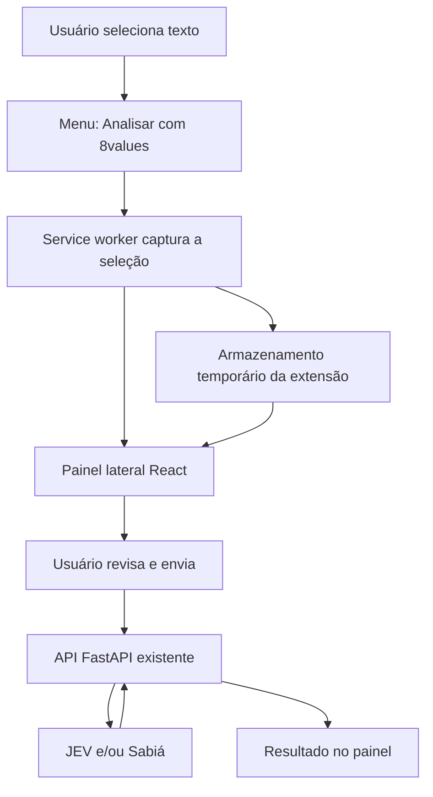

# Plano da extensão 8values + textos

Data: 13/10/2026. Base: aplicativo React e API FastAPI existentes neste projeto.

Permitir que o usuário selecione um trecho de uma página, escolha **Analisar com 8values**, revise o texto e consulte seus quatro eixos políticos em um painel lateral. Reaproveitar os componentes e o pipeline do app, mantendo os resultados ao lado da leitura.

Este documento registra o plano original. Em 13/10/2026 foram implementados o pacote compartilhado, a extensão local, a integração com a API, o histórico, a recuperação de interrupções e a importação/exportação de perfil. O pacote compilado foi exercitado em Chrome e Edge com API simulada. Consulte [instalação](C:/Users/User/Desktop/TCC/app/extension/README.md) e [limites da validação](C:/Users/User/Desktop/TCC/app/extension/VALIDACAO.md). A distribuição pública depende de API HTTPS e controle de acesso; o menu nativo e os provedores reais têm verificações manuais pendentes.

## 1. Escopo inicial

| Decisão | Proposta |
|---|---|
| Navegadores | Chrome como primeira implementação; validar o mesmo pacote no Edge |
| Plataforma | Manifest V3, React, TypeScript e Vite |
| Entrada principal | Seleção de texto e menu do botão direito |
| Interface | Painel lateral com revisão, processamento e resultado |
| Análise | API FastAPI existente, nos modos baixo, médio e alto |
| Persistência | Rascunho e histórico temporários; preferências locais |
| Perfil pessoal | Comparação com o teste em uma segunda etapa |
| Primeiro ambiente | Extensão carregada localmente e API em `http://127.0.0.1:8000` |

O MVP cobre textos selecionáveis em páginas HTTP/HTTPS e texto colado manualmente no painel. Análise automática de páginas, OCR, PDFs, botão flutuante, leitura integral de artigos e suporte a Firefox ficam para evoluções posteriores.

Chrome permite abrir o painel a partir de uma ação no menu de contexto; `sidePanel.open()` está disponível desde a versão 116. Adotar esse piso técnico e confirmar as APIs efetivamente usadas ao montar o pacote. O Edge documenta suporte à mesma API, mas precisa de validação própria. [Chrome Side Panel](https://developer.chrome.com/docs/extensions/reference/api/sidePanel), [painel lateral do Edge](https://learn.microsoft.com/en-us/microsoft-edge/extensions/developer-guide/sidebar).

## 2. Jornada do usuário

1. O usuário seleciona um parágrafo de uma notícia, artigo ou publicação.
2. Clica com o botão direito e escolhe **Analisar com 8values**.
3. O painel abre com o trecho preenchido em um campo editável, contador de caracteres e origem resumida, quando disponível.
4. Escolhe **Baixo**, **Médio** ou **Alto**. O painel consulta a API para indicar os modos disponíveis. Começa em médio, como o app; se indisponível, solicita a escolha de outro modo disponível.
5. Vê quais serviços receberão o texto e clica em **Analisar texto**.
6. Acompanha o tempo decorrido e pode cancelar a requisição.
7. Recebe as barras dos quatro eixos, cobertura, limitações e evidências disponíveis.
8. Pode editar e reanalisar o texto, consultar o histórico da sessão ou limpar os dados temporários.

A seleção e a abertura do painel não enviam o texto à API. O envio ocorre no botão **Analisar texto**. Cada envio continua independente, sem incorporar o histórico como contexto.

Ao clicar no ícone da extensão, abrir o mesmo painel com o último rascunho ou uma área vazia para colar texto. Capturar a seleção por esse ícone exigiria outro mecanismo; não faz parte do primeiro fluxo.

Uma nova seleção recebida durante uma análise fica como próximo rascunho. Ela não altera o texto associado à requisição em andamento. Se já houver edição não enviada, oferecer **Usar nova seleção** e **Manter rascunho**.

## 3. O que aproveitar do app

| Base existente | Aproveitamento e ajuste |
|---|---|
| [AnalysisPage.tsx](C:/Users/User/Desktop/TCC/app/web/src/features/analysis/AnalysisPage.tsx) | Separar formulário, estado da requisição e apresentação do resultado da página completa |
| [analysisApi.ts](C:/Users/User/Desktop/TCC/app/web/src/services/analysisApi.ts) | Compartilhar contratos e tratamento de erros; permitir configurar a URL base |
| [AxisBar.tsx](C:/Users/User/Desktop/TCC/app/web/src/components/AxisBar.tsx) | Reutilizar as barras, com ajuste de layout para painel estreito |
| [AnalysisRadar.tsx](C:/Users/User/Desktop/TCC/app/web/src/features/analysis/AnalysisRadar.tsx) | Reutilizar como visualização opcional em detalhes |
| [IdeologyMatch.tsx](C:/Users/User/Desktop/TCC/app/web/src/components/IdeologyMatch.tsx) | Manter secundário, somente quando os quatro eixos tiverem estimativas |
| [axes.ts](C:/Users/User/Desktop/TCC/app/web/src/domain/axes.ts) | Compartilhar nomes, ordem e orientação dos polos |
| [analysisHistory.ts](C:/Users/User/Desktop/TCC/app/web/src/features/analysis/analysisHistory.ts) | Reaproveitar o modelo de entrada; substituir o mecanismo de armazenamento na extensão |
| [ComparisonPanel.tsx](C:/Users/User/Desktop/TCC/app/web/src/features/comparison/ComparisonPanel.tsx) | Reutilizar na segunda etapa, adaptando a ação que hoje usa React Router |
| [routes/analyze.py](C:/Users/User/Desktop/TCC/app/api/app/routes/analyze.py) | Manter os endpoints e os três modos de processamento |
| [schemas.py](C:/Users/User/Desktop/TCC/app/api/app/schemas.py) | Preservar o contrato de entrada e saída |

Criar um pacote interno compartilhado, consumido pelo site e pela extensão. Ele deve conter componentes de resultado, tipos, domínio e cliente HTTP, sem dependência das APIs do navegador. Componentes compartilhados recebem ações por propriedades, evitando acoplamento às rotas do site.

Manter React como dependência compartilhada/peer do pacote para evitar duas cópias no bundle. Extrair também os estilos necessários: alguns componentes dependem de classes globais do site, além de CSS Modules.

## 4. Arquitetura



### Captura e abertura

O service worker registra um menu com `contexts: ['selection']`, limitado a documentos HTTP/HTTPS. O evento fornece `info.selectionText`; esse caminho dispensa injetar um script nas páginas. [API de menus de contexto](https://developer.chrome.com/docs/extensions/reference/api/contextMenus).

No clique, criar uma captura com identificador único, texto, horário, janela e aba de origem. Guardar apenas o domínio como referência visual local, descartando parâmetros e fragmentos da URL. Não depender de título da aba nem solicitar permissão adicional para obtê-lo.

Invocar `sidePanel.open({ windowId })` diretamente no evento do usuário, antes de aguardar operações assíncronas. Gravar a captura em seguida. O painel deve assinar mudanças no armazenamento antes de carregar o estado inicial e reconciliar tudo pelo identificador da captura, cobrindo a corrida entre sua abertura e a gravação.

Organizar os dados por janela para não misturar duas leituras simultâneas. Trocar de aba mantém o trecho em análise e sua origem visível; só uma nova ação explícita muda a seleção recebida.

### Execução da análise

Executar o `fetch` no documento do painel, com `AbortController`. Deixar o service worker responsável pelos eventos curtos de captura e abertura.

Essa decisão considera os 120 segundos configurados por padrão na API: o Chrome pode encerrar o service worker quando uma resposta de `fetch` demora mais de 30 segundos a chegar. [Ciclo de vida do service worker](https://developer.chrome.com/docs/extensions/develop/concepts/service-workers/lifecycle).

Ao fechar ou recarregar o painel, preservar o rascunho e os resultados já concluídos. Uma requisição cuja execução foi perdida deve aparecer como **interrompida** ao reabrir, sem reenvio automático. Usar um identificador de requisição para impedir que uma resposta antiga substitua um resultado mais recente.

O cancelamento interrompe a espera e solicita o aborto HTTP; a API já observa desconexões. Não prometer desfazer chamadas que os provedores já tenham recebido. Continuidade garantida com painel fechado exigiria uma etapa futura com tarefas assíncronas no backend.

## 5. Integração com a API

Manter os endpoints atuais:

| Endpoint | Uso |
|---|---|
| `GET /api/health` | Diagnóstico de conexão |
| `GET /api/capabilities` | Limites, disponibilidade de modos e prazo de processamento |
| `POST /api/analyze` | Processar o texto escolhido |

O corpo do envio permanece:

```json
{
  "text": "Trecho selecionado e revisado pelo usuário",
  "processing_level": "medium"
}
```

URL, título, perfil do questionário e histórico não entram nesse corpo. O contrato atual rejeita campos extras.

Hoje o cliente usa caminhos relativos a `/api` e o Vite encaminha as chamadas no desenvolvimento. A extensão precisará de uma URL absoluta. Transformar o cliente em uma função configurável, mantendo o comportamento atual no site e usando o endereço da API na extensão.

A configuração pública pode usar `VITE_API_BASE_URL`; chaves TypeSafe e Maritaca permanecem no servidor. Consultar as capacidades antes de habilitar o envio e oferecer nova tentativa se o servidor estiver indisponível.

As requisições partem da origem da extensão, com `host_permissions` para o host da API. Esse fluxo tem permissões de rede diferentes das de scripts injetados; não exige liberar CORS para todos os sites. Verificar também a política CSP do pacote e eventuais restrições de origem do proxy. [Requisições de rede em extensões](https://developer.chrome.com/docs/extensions/develop/concepts/network-requests).

Tratar seleção vazia, limite excedido, indisponibilidade de rede, respostas inválidas e os erros já previstos: 413, 422, 429, 503 e 504. Preservar o texto após falhas. Limites de caracteres podem ser conferidos no painel; tokens e quantidade de trechos continuam sendo validados no servidor.

Adicionar prazo de espera no cliente, baseado em `timeout_seconds` com pequena margem de rede. Isso limita a espera do usuário; a API atual inicia seu prazo de processamento após adquirir a vaga de concorrência. Não refazer automaticamente um POST que possa já ter consumido chamadas.

## 6. Painel e interpretação

Usar uma coluna, confortável em larguras de aproximadamente 360–480 px:

| Bloco | Conteúdo |
|---|---|
| Cabeçalho | Nome da extensão, nova análise e histórico |
| Texto | Origem local, campo editável, contador e limite |
| Processamento | Três modos, disponibilidade e destinatários do envio |
| Ação | Analisar, cancelar e estado da requisição |
| Resultado | Quatro barras, cobertura e avisos |
| Detalhes | Texto analisado, evidências, distribuição dos níveis, radar e modelos utilizados |

Priorizar barras e evidências na área estreita. Reusar as cores, tipografia e nomes do app, com foco visível, navegação por teclado e estados anunciados por `aria-live`.

Preservar as regras metodológicas atuais:

- Eixos: econômico, diplomático, civil e social.
- Ausência de estimativa continua sendo ausência de estimativa, sem substituição por 50.
- Trechos curtos poderão apresentar **Evidência limitada**: o backend exige 16 trechos válidos por eixo para marcar evidência suficiente. Não alterar esse critério para a extensão.
- Mostrar citações apenas quando devolvidas e verificadas pelo pipeline. O modo JEV não produz citações justificativas.
- O resultado descreve o trecho selecionado. Não apresentá-lo como classificação de todo o site ou da pessoa que escreveu.
- Manter o aviso de que a IA pode cometer erros e a ideologia mais próxima como informação exploratória.

## 7. Permissões e armazenamento

| Item | Necessidade no MVP |
|---|---|
| `contextMenus` | Ação sobre o texto selecionado |
| `sidePanel` | Exibição do painel |
| `storage` | Rascunhos, histórico e preferências |
| `host_permissions` | Somente o host da API configurada |

O fluxo proposto não precisa de `tabs`, `activeTab`, `scripting`, acesso à área de transferência ou `<all_urls>`. Uma futura captura por atalho ou botão dentro da página deverá justificar as permissões adicionais.

Criar configurações de desenvolvimento e produção separadas. A primeira permite o host local; a segunda aponta para o host HTTPS efetivamente publicado. Gerar a URL base, permissões e `connect-src` de uma configuração coerente.

Usar `chrome.storage.session` para rascunhos e histórico. Essa área permanece em memória enquanto a extensão está carregada e é apagada em reinício do navegador, recarga, atualização ou desativação da extensão. Preferências simples podem ficar em `chrome.storage.local`. [Armazenamento de extensões](https://developer.chrome.com/docs/extensions/reference/api/storage).

Proposta inicial: até 10 análises recentes e orçamento conservador de armazenamento, medido antes da gravação. Remover entradas antigas quando necessário e avisar se um resultado não puder ser guardado. Não usar sincronização entre dispositivos para os textos. Disponibilizar **Limpar histórico e rascunhos**.

A hidratação do armazenamento será assíncrona: não salvar o estado vazio antes da leitura inicial. Renderizar seleção e evidências como texto React, sem inserir HTML da página.

## 8. Comparação com o usuário: segunda etapa

O site salva o perfil no `localStorage` da sua própria origem. A extensão possui outra origem, portanto não encontra esse perfil automaticamente.

Para reaproveitar a comparação existente, propor exportação e importação explícitas de um JSON contendo apenas o perfil agregado: `schema_version`, `question_hash`, `completed_at` e `scores`. Essa funcionalidade ainda precisa ser criada no site e na extensão.

Validar a versão, o hash do questionário e os valores de 0 a 100 antes de aceitar o arquivo. Extrair a validação existente de `readProfile()` para uma função compartilhada. Oferecer uso temporário ou salvamento local e exclusão do perfil.

Adaptar `ComparisonPanel` para receber ações de navegação por propriedades. A comparação continuará no navegador, sem enviar o perfil à API e sem criar um índice global de compatibilidade.

## 9. Organização proposta

```text
app/
  package.json                 # workspace para web, extension e shared
  web/                         # aplicação existente
  api/                         # API existente
  shared/
    package.json
    src/
      api/                     # cliente configurável e contratos
      domain/                  # eixos e regras compartilhadas
      components/              # formulário e apresentação reutilizáveis
      styles/
  extension/
    package.json
    manifest.json
    vite.config.ts
    sidepanel.html
    public/icons/
    src/
      background.ts            # menu e abertura do painel
      sidepanel/
        main.tsx
        ExtensionApp.tsx
      storage/
        sessionStore.ts
        preferences.ts
      platform/
        selection.ts
        panel.ts
      config.ts
```

O build deve produzir um pacote autossuficiente, com scripts e estilos locais. Preservar os comandos documentados do site ou atualizar claramente suas instruções ao introduzir o workspace. Adaptar os testes que mudarem de pacote, sem duplicar regras de classificação.

## 10. Etapas de implementação

| Etapa | Trabalho | Critério de conclusão |
|---|---|---|
| 1 — Compartilhamento | Extrair contratos, cliente configurável, componentes e estilos | Site mantém a análise e seus testes/build passam |
| 2 — Captura | Manifest, service worker, menu e painel React | Seleção aparece completa no painel sem chamada de análise |
| 3 — Integração | Capacidades, modos, envio, erros e cancelamento | Texto selecionado é analisado pela API existente |
| 4 — Resultado e sessão | Barras, evidências, rascunho, histórico e recuperação | Fechar/reabrir preserva dados concluídos e trata interrupções |
| 5 — Validação do MVP | Build instalável, instruções e testes nos navegadores | Fluxo aprovado no Chrome e no Edge testados |
| 6 — Comparação opcional | Exportar/importar perfil e adaptar comparação | Perfil permanece local e comparação funciona por eixo |
| 7 — Distribuição | API HTTPS, proteção de acesso, pacote e documentação de dados | Preparação para distribuição concluída |

Para distribuição pública, resolver o controle de acesso e consumo da API: hoje não há autenticação e os contadores de uso são globais por processo. A extensão não pode guardar um segredo compartilhado que proteja o serviço. Essas decisões são necessárias antes de disponibilizar uma API pública; o protótipo acadêmico pode começar com o servidor local.

## 11. Verificação e aceite do MVP

- Selecionar texto em página comum, página dinâmica e iframe; validar a captura fornecida pelo navegador, incluindo acentos e quebras de linha.
- Confirmar que selecionar ou abrir o painel não envia conteúdo; o POST leva apenas o trecho revisado e o modo.
- Testar texto vazio, limite de caracteres, rejeição por tokens, API desligada e modo indisponível.
- Usar API simulada com demora superior a 30 segundos para verificar a execução no painel e testar o prazo máximo sem consumir provedores.
- Cancelar, fechar/reabrir o painel e reiniciar o service worker; nenhum caso pode reenviar a análise automaticamente ou deixar estado ocupado permanente.
- Receber duas seleções rápidas e trabalhar em duas janelas; rascunho, origem e resultado devem permanecer associados corretamente.
- Verificar resultados sem evidência, abstenção e estimativas parciais; não preencher eixos ausentes nem inventar citações.
- Exercitar remoção de entradas antigas, falha de armazenamento e limpeza dos dados temporários.
- Conferir teclado, leitor de tela, textos longos e ausência de rolagem horizontal no painel estreito.
- Rodar os testes e build existentes após a extração, adicionar testes das transições críticas da extensão e instalar o pacote final nos dois navegadores-alvo.

O MVP estará concluído quando for possível selecionar um trecho, revisá-lo, escolher um modo, analisá-lo e consultar resultados e evidências ao lado da página, com comportamento previsível em falhas e interrupções.

## 12. Evoluções posteriores

Adicionar comparação pessoal, atalho de teclado, botão flutuante opcional e abertura do resultado em uma aba maior conforme necessidade de uso. A captura adicional deve ser acionada pelo usuário.

Para Firefox, criar uma adaptação de plataforma e manifest em torno de `sidebarAction`, preservando os componentes React e a API. Essa API difere do painel do Chromium; a compatibilidade exigirá implementação e testes próprios. [Documentação Mozilla](https://developer.mozilla.org/en-US/docs/Mozilla/Add-ons/WebExtensions/API/sidebarAction).
